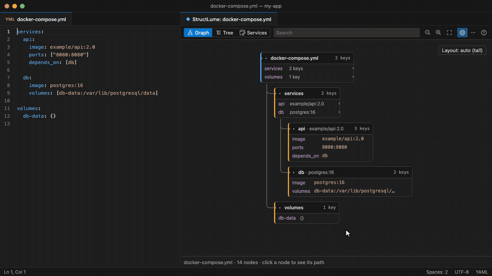

<h1 align="center">StructLume — YAML Visualizer</h1>

See your YAML files as a diagram, right beside the editor in VS Code.

## Install

Get it from the [VS Code Marketplace](https://marketplace.visualstudio.com/items?itemName=structlume-dev.structlume), or run `ext install structlume-dev.structlume` in VS Code's Quick Open (`Ctrl+P` / `Cmd+P`).

## Feedback

Found a bug or have an idea? [Open an issue](https://github.com/nyadav17/StructLume-assets/issues) in this repository.

## About this repository

This repository hosts the Marketplace listing images and the public issue tracker for StructLume.

## License

[MIT](LICENSE)
